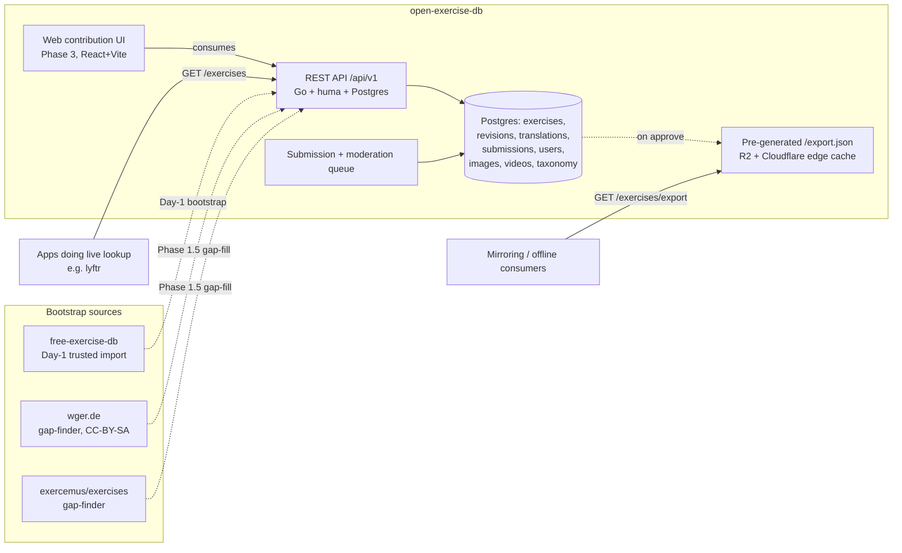
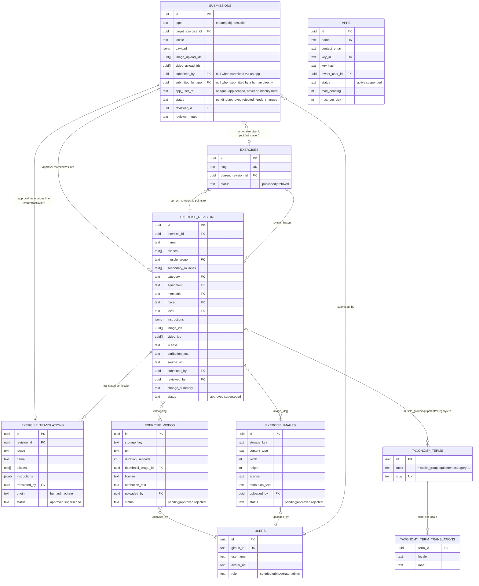

# open-exercise-db — Design

A community-maintained, open exercise database platform — "OpenFoodFacts but for fitness."

## Why this exists

Fitness apps that want a free exercise catalog today lean on
[`yuhonas/free-exercise-db`](https://github.com/yuhonas/free-exercise-db) — a great
public-domain (Unlicense) dataset of ~800 exercises, but its GitHub repo has PRs sitting
unmerged for months, with no active review queue. Other options exist but none combine what
a real "OpenFoodFacts for fitness" needs:

- **[wger.de](https://wger.de)** — live, actively maintained (6.5k★, same-day PR merges),
  has its own exercise API and contribution/moderation workflow. The closest prior art, but
  it's a full self-hosted fitness *tracker* app (not a focused exercise-DB microservice), and
  its data is CC-BY-SA 4.0 (share-alike), not the friction-free CC0 this project targets.
- **[exercemus/exercises](https://github.com/exercemus/exercises)** — aggregates
  exercemus.com + wger.de + free-exercise-db into a dataset, including image URLs and
  embeddable YouTube links. Closest attempt at "the thing," but it's a static generated JSON
  dataset: no live moderation queue, no translations, no versioned/revertible revisions.
- **[ExerciseDB](https://github.com/ExerciseDB/exercisedb-api)** (RapidAPI) — 11,000+
  exercises but a closed, commercially-monetized dataset, not community-contributed.

None combine: open community submission + moderation queue, translations, versioned/
revertible revisions, a CC0 data license, and an API-first documented surface. That's the gap
this project fills.

## Core principles

1. **Moderation queue fully separate from published data.** Nothing unreviewed is ever
   visible through the public API.
2. **Published data is append-only/versioned.** Every edit is trivially reversible — a revert
   is just repointing a pointer, never mutating history.
3. **API-first.** The full read+write API ships and gets hardened *before* any web UI exists.
   If the UI ever needs something the API can't do, that's an API gap, not a UI-only feature.
4. **Translations and controlled vocabulary are data, not schema.** Adding a language is a
   row insert, never a migration.

## Architecture



## Data model (Postgres)

Postgres from day one, not SQLite — this is a multi-consumer public API and needs real
concurrent-write safety, not a single-tenant deployment. See [Alignment with Open Food
Facts](#alignment-with-open-food-facts-actual-stack) below for why this stays Postgres-first
rather than Mongo-first even though OFF itself started on Mongo.



Notes on the structural choices:

- **`exercises` ↔ `exercise_revisions` is deliberately circular.**
  `exercises.current_revision_id` points forward to whichever revision is live; every
  revision points back via `exercise_id`. A revert is rewriting that one pointer — nothing in
  `exercise_revisions` is ever mutated or deleted, so full history is always reconstructable
  and reverts are instant.
- **`submissions` never writes directly into published tables.** It holds a `payload JSONB`
  shaped like whatever it'll become, and only `POST /admin/submissions/{id}/approve`
  materializes it. That's the moderation-queue-separate-from-published-data guarantee
  enforced at the schema level, not just by API convention.
- **A submission is attributed to a person *or* to an app, never neither.** `submitted_by`
  and `submitted_by_app` are both nullable and exactly one is set — a `CHECK` constraint, not
  a convention, because "who sent this" is the input to every abuse control downstream.
  `app_user_ref` is whatever opaque handle the app uses for the human behind the submission.
  It is deliberately **not** an identity in this system: no row, no email, no login. It exists
  so a single bad actor inside an app can be blocked without banning the whole app, and so an
  app can answer "what happened to my edit?" for its own user. Treating it as an identity
  would drag this project into storing third-party user data it has no reason to hold.
- **`apps` stores a hashed key, never the key.** `key_id` is the public half sent on every
  request; `key_hash` is what's compared. `max_pending`/`max_per_day` are per-app because a
  single app is the aggregate of thousands of humans — a limit sized for one contributor is
  the wrong limit for lyftr, in both directions.
- **`taxonomy_terms`/`taxonomy_term_translations`** exists to close a gap Open Food Facts'
  own model exposes: `muscle_group`, `equipment`, `category`, `mechanic`, `force`, `level`
  aren't free text, they're slugs into a small controlled vocabulary that itself gets
  translated — so `GET /meta/muscle-groups?locale=es` returns real labels, not only ever
  English strings. (Deliberately much simpler than OFF's actual taxonomy system, which is
  hierarchical/nested for food categories — our facets are flat enums.)
- **Images/videos are separate tables**, referenced from a revision via `image_ids[]`/
  `video_ids[]` arrays rather than a join table — simpler for this cardinality (an exercise
  has a handful of media items, not enough to warrant a many-to-many join table with its own
  metadata).

**Indexes:** `exercises.slug` (unique), `exercises.status`, `exercise_revisions(exercise_id,
status)`, `exercise_translations(revision_id, locale)` unique, `submissions.status`,
`exercise_images.status`, plus every `/exercises` list-filter column (`muscle_group`,
`equipment`, `category`) — `/exercises` is the highest-traffic endpoint.

## Bootstrap data

- **Day 1 seed = free-exercise-db's ~800 exercises**, imported directly via
  `cmd/import-freeexercisedb` (trusted first-party seed, bypasses the submissions queue):
  `status='approved'`, `submitted_by=NULL`, `license='Unlicense'`,
  `source_url='https://github.com/yuhonas/free-exercise-db'`. Images are **re-hosted** (own
  storage, re-encoded to JPEG and capped at ~800px on the long edge — see Tech stack below for
  why JPEG rather than webp), never hotlinked from GitHub raw URLs — hotlinking a third party is
  exactly the fragility this project exists to remove.
- **wger and exercemus as gap-finders, not bulk imports.** wger's data is CC-BY-SA 4.0 —
  bulk-importing it would taint an otherwise-CC0 corpus with share-alike obligations. Default:
  diff wger's exercise list (and exercemus's aggregated dataset, which already merged
  wger + free-exercise-db + exercemus.com and includes image/video links neither of the
  others has; because it includes wger data it is reference for finding gaps only, never a source to copy from) against what's already imported; a human writes an *original* CC0 description
  for each gap, optionally crediting the source via `source_url` for provenance even though
  the text is rewritten. There is no import-as-CC-BY-SA fallback: the corpus is CC0 only, and
  wger content must never be imported, however large the gap.

### Seed completeness bar (Phase 1.5, before any public submission opens)

Public contributions don't open until the seed itself clears a real bar, not a calendar date:

- Every published exercise has non-empty `muscle_group` + `category` + `equipment`,
  instructions as complete sentences, and a target of ≥95% of exercises with at least one
  re-hosted image.
- **Draft (non-authoritative) machine translations**, clearly marked. Bootstrap-time machine
  translation into a handful of high-value locales (`es`, `pt-BR`, `fr`, `de`) so the
  platform doesn't launch with zero non-English coverage — inserted with
  `exercise_translations.origin='machine'`, surfaced in the API/UI as "machine-translated,
  needs review" rather than looking human-verified. Human contributors promote/correct them
  through the normal submission flow.

## API (REST, JSON, `/api/v1`)

OpenAPI 3.1 spec generated from Go types by [huma v2](https://huma.rocks/) from day one,
served at `/api/v1/openapi.json` with a docs UI at `/docs`, on a versioned path so early
consumers (lyftr included) aren't broken by iteration. Generating the spec from the handler
input/output types is what makes "API-first" enforceable — the spec cannot drift from the
code. See [`CONVENTIONS.md`](CONVENTIONS.md) section 3 for the handler patterns, and
section 3a for the payload standard every endpoint below conforms to: bare single resources,
named collection key + `total`/`page`/`per_page` on every list, and RFC 9457 problem details
carrying a stable `type` URI on every error.

```
# Read — public, no auth
GET /exercises?q=&muscle_group=&equipment=&category=&mechanic=&level=&locale=&page=&per_page=
GET /exercises/{id}?locale=                 # falls back to English if no translation
GET /exercises/{id}/revisions?page=&per_page=
GET /exercises/{id}/translations?page=&per_page=
GET /exercises/export                       # pre-generated static JSON, CDN-served
GET /meta/muscle-groups | /equipment | /categories | /locales   # ?locale=, ?page=, ?per_page=
GET /images/{id}                            # re-hosted image bytes — see Images below

# Write — auth required: GitHub-OAuth JWT (a person) or app credentials (an app)
POST /submissions                           # { type, locale?, payload, image_upload_ids[], video_upload_ids[] }
POST /exercises/{id}/submissions            # shorthand: type='edit'
POST /exercises/{id}/translations           # shorthand: type='translation'
GET  /submissions/mine
POST /images                                # multipart -> image_upload_id
POST /videos                                # multipart or { url } -> video_upload_id

# Moderation — role in {moderator, admin}
GET  /admin/submissions?status=pending&type=
GET  /admin/submissions/{id}                # includes diff-against-current
POST /admin/submissions/{id}/approve        # body may carry edited payload
POST /admin/submissions/{id}/reject         # { reason }
POST /admin/exercises/{id}/revert/{revision_id}
```

`/export` serves this project's own canonical exercise shape — the same field names
`/exercises` returns, so a consumer that starts with the bulk dump and later moves to live
lookups (or the reverse) doesn't rewrite its mapping. It is deliberately **not** shaped to
any single consumer's schema: consumers adapt to this API, not the other way round. See
[Consuming this API](#consuming-this-api).

### Images

`contract.Exercise.images[]` (rendered identically by `/exercises`, `/exercises/{id}`, and
`/exercises/export` — one shared Go type, see `internal/contract/doc.go`) carries `id`, `url`,
`width`, `height`, `content_type`, `license`, and `attribution_text` per image — enough for a
client to fetch and render it directly, modeled on Open Food Facts' own per-product image
metadata. This replaced an earlier `image_ids` field that shipped only opaque UUIDs with no
resolution path — a consumer could never actually display an image, which is the defect this
shape exists to close.

`url` is resolved from `IMAGE_BASE_URL` (`internal/config.Config.ImageBaseURL`,
`internal/media.ImageURL`):

- **Set** (production): `{IMAGE_BASE_URL}/{storage_key}`, pointing straight at object
  storage/CDN — image bytes never touch the API process, the same split OFF gets from
  `images.openfoodfacts.org`. Must be a custom domain: Cloudflare rate-limits the managed
  `*.r2.dev` subdomain and documents it as development-only.
- **Unset** (local dev, self-host — the default): falls back to this API's own
  `GET /images/{id}`, which streams the identical bytes through `media.Store.Get`. Long
  `Cache-Control: immutable` (image bytes never change once stored — a re-import that matches
  an existing upload reuses its row rather than writing a new one) and the same conditional-GET
  `ETag`/`If-None-Match` handling every other `GET` in this API uses.

The server logs a warning when `IMAGE_BASE_URL` and the storage backend disagree
(`internal/config.Config.Warnings`) — neither combination is refused, because filesystem
storage plus a set `IMAGE_BASE_URL` is also how a self-hoster serving `MEDIA_DIR` through
nginx would legitimately configure this, and the process can't tell that apart from a
misconfiguration. Silence means the two agree.

Either way `contract.Exercise` doesn't change shape — only which host the URL points at, which
is exactly the config-not-code seam that lets production adopt OFF's separate-image-host model
later without touching a client.

#### Renditions (`variants[]`)

Each image also carries `variants[]` — one entry per stored rendition, with its own `name`,
`url`, `width`, `height`, and `content_type`, `full` first. Today every image has exactly one,
`full`, whose `url` is byte-identical to the image's own `url`: one set of bytes never lives at
two cacheable URLs. Individual renditions are fetchable at `GET /images/{id}/{variant}`, and an
unknown name is a **404, never a fallback to `full`** — a client asking for a thumbnail and
silently receiving a full-resolution image sees a successful request while downloading many
times the bytes it budgeted for, on exactly the connections thumbnails exist to protect.

`variants[]` is purely additive: `url`, `width`, `height`, and `content_type` keep describing
the full rendition exactly as before, so a consumer written against the earlier shape needs no
change and has no deprecation to track.

The reason this landed before a second size exists is that **a storage key is now data, not a
derived convention**. The importer used to compute `exercises/<source-id>/<index>.jpg` and
every reader re-derived the same string — sound for exactly one rendition per image, and a
bucket-wide rename the moment there are two. `exercise_image_variants` records each rendition's
key, so added sizes name their own objects and the existing ones never move. That is what keeps
the production R2 backfill a one-time copy rather than something that has to be redone once
thumbnails exist.

**Bytes never live in Postgres**, mirroring OFF's own product-image handling: `exercise_images`
stores metadata only (`storage_key`, `content_type`, dimensions, license/attribution),
`media.Store` holds the actual bytes — `R2Store` against Cloudflare R2 when the four `R2_*`
settings are present, `FilesystemStore` at `MEDIA_DIR` otherwise. Both accept exactly the same
key space (`media.ValidateKey`), which is what makes `cmd/migrate-media` a straight copy with
no database migration: `storage_key` is identical on both sides, so moving backends is a config
change and the rows never move. A relational
database is the wrong place for binary blobs at any real scale — no query ever needs to filter
or join on image *content*, only its metadata, so storing bytes there would just make routine
backups/replication larger and slower for zero query benefit.

Multiple pre-generated resolutions (OFF serves 100/200/400px + full-size variants per image) are
explicitly out of scope for Phase 1 — `GET /images/{id}` always serves the one re-encoded,
~800px-capped version `internal/media/encode.go` produces at import time. A Phase 2 follow-on if
thumbnail-sized responses turn out to matter for a real consumer.

**Build order:** Phase 1 ships every `GET` above, no auth. Phase 1.5 enriches seed data (no
new endpoints). Phase 2 adds auth + every write/moderation endpoint — by the end of Phase 2
the platform is fully usable via `curl`/Postman/`/docs`, zero web UI written. Phase 3 builds
the web UI purely as a consumer of the already-complete API.

## Performance, cost, and concurrency

Built for "many independent API consumers hitting this concurrently, on a free/near-free
budget":

- **`/export` is pre-generated, not computed per-request.** It's the heaviest endpoint and
  one every mirroring consumer hits — regenerated once on every approved submission/revert, written
  to R2, served directly by the CDN. Consumers doing a full sync never touch the database or
  the Go process at all.
- **Cache-Control/ETag on every `GET`.** Exercise data changes rarely; long `max-age` +
  `stale-while-revalidate` behind a Cloudflare proxy means repeat reads from many consumers
  hit edge cache, not backend compute.
- **Connection pooling sized to the free tier.** `pgxpool` with a small max-conns (5-10)
  matched to the managed provider's free-tier connection limit.
- **Concurrency correctness, not just capacity** — the concrete reason Postgres was picked
  over SQLite: real transactional guarantees for concurrent submission approval, revert, and
  translation writes. A `concurrent_submission_test.go` fires concurrent approve/revert calls
  and asserts `current_revision_id` never lands in a torn state.
- **Load verification before v1 is "done."** A basic `k6`/`hey` run against `/exercises` and
  `/export` simulating realistic multi-consumer concurrent load, confirming cached responses
  stay well under 200ms and sustained load fits inside the free-tier allowance.
- **Origin-level rate limiting on reads, not just writes.** Open Food Facts' own operational
  experience is the reason this isn't fully deferred — they still hit abusive-crawling
  problems even with caching in front, and respond with global rate limits (503). A basic
  Cloudflare rate-limiting rule is cheap enough to include as a v1 item.

**Cost ceilings** (so "free" has a concrete boundary):

| Resource | Free tier ceiling | Upgrade trigger |
|---|---|---|
| Supabase Postgres | 500MB database, 5GB egress, pauses after 7 days idle (see the keepalive in `DEPLOYMENT.md`) | Database size or egress past the free ceiling |
| Google Cloud Run | 2M requests/mo, 240K vCPU-sec/mo, 450K GiB-sec/mo | Sustained request volume past the free monthly allowance |
| Cloudflare R2 | 10GB storage, free egress | Image/video storage past 10GB (egress stays free indefinitely) |
| Cloudflare Pages | Effectively unlimited for a static SPA | Not expected to be a constraint |

## Web contribution UI (Phase 3 — after the API is complete)

`/` browse+search · `/exercises/{slug}` detail (images/videos, locale toggle incl. a visible
"machine-translated, needs review" badge, "Suggest an edit"/"Add a translation", revision
history) · `/exercises/new` submit form · `/exercises/{slug}/edit` ·
`/exercises/{slug}/translate/{locale}` side-by-side editor · `/submissions/mine` ·
`/admin/queue` (moderator+: diff view, approve/reject/request-changes) · `/login`.

**Auth: two credential types, one submission pipeline.**

*People* authenticate with **GitHub OAuth** (authorization-code flow, not a full GitHub App) —
no passwords, appropriate for a dev-heavy early contributor base. Bootstrap the first admin
via `ADMIN_GITHUB_LOGINS`, auto-promoted on first login.

*Apps* authenticate with **their own credentials** and submit on behalf of their users, who
have no account here at all. This is Open Food Facts' model, and it exists for a specific
reason: OFF's contribution volume does not come from people visiting openfoodfacts.org, it
comes from third-party apps like Yuka whose users never knowingly interact with OFF. An app
sends its key plus `app_user_ref`, an opaque handle for the human behind the edit.

**GitHub-only auth would have quietly killed in-app contribution.** The first real consumer of
this API is lyftr, whose users are gym-goers; requiring a GitHub account to fix a typo in an
exercise description is a wall almost none of them would climb. The failure mode is not that
contribution is hard — it is that no contribution ever arrives and the cause is invisible,
because the people who would have contributed simply close the screen. Discovering that after
building the OAuth-only flow would mean rebuilding the submission path, the schema's
attribution columns, and every rate limit keyed on user id.

Note the groundwork already half-exists: `internal/api/ratelimit.go` requires an
`AppName/Version (ContactEmail)` User-Agent, lifted directly from OFF's own convention. That
identifies apps for *throttling* but stops short of identifying them for *writing*. This
extends the same idea to the write path rather than inventing a second scheme.

**Review still gates publication.** Adopting OFF's auth model is not adopting OFF's
publication model — OFF is write-through, where edits go live instantly and moderation is
cleanup afterward, and this project is not. Guarantee #1 above stands: nothing unreviewed is
ever published, whether it came from a person or an app. OFF can absorb write-through because
three million products make any single bad edit statistically invisible; 873 exercises cannot,
and the first consumer is shipping this data to real users.

The cost of that choice is honest and worth stating: **the maintainer is the throughput
bottleneck**, and an app with a large user base can generate submissions far faster than one
person approves them. The escape hatch, when that day comes, is **trust tiers** rather than
abandoning review — an app with a track record graduates to write-through for low-risk changes
(translations, typos, filling an empty optional field) while new exercises stay queued. That is
the same shape as the existing tiered rate limits, and it is deliberately deferred: building it
before there is any evidence of the bottleneck would be guessing at which changes are actually
low-risk.

## Moderation / anti-abuse

Single-maintainer approve/reject queue (`role` field future-proofs adding reviewers).
Authentication required to submit (kills anonymous spam), a plain SQL rate-limit, image/video
size caps + mandatory re-encode, `go-playground/validator` field validation. Explicitly
deferred as premature at this scale: CAPTCHA, ML spam detection, trust tiers.

The rate-limit caps — pending submissions and a rolling 24h count — apply **per app** as well
as per user, from the app's own `max_pending`/`max_per_day` rather than a global constant.
A per-user limit applied to an app is wrong in both directions at once: it throttles a
legitimate app with thousands of users down to one person's budget, and it lets a thousand
bogus `app_user_ref` values through under a single app credential. Two levers, because an app
misbehaving and a person misbehaving need different responses:

- **Suspend the app** (`apps.status`) — stops everything from that source.
- **Block one `app_user_ref`** — stops one bad contributor without punishing the app or its
  other users, which is the whole reason the column exists.

An app's key is revocable and rotatable independently of its submission history: rotating
`key_id`/`key_hash` leaves every past `submissions.submitted_by_app` reference intact, so
credential rotation never costs attribution.

## Alignment with Open Food Facts' actual stack

This is Postgres-first from day one, where OFF *started* Mongo-first and only later grew a
Postgres layer (`openfoodfacts-query`) because raw Mongo aggregation wasn't fast enough for
facet queries — applying that lesson a step early rather than retrofitting it.

- **Why not Mongo-first, given OFF is?** OFF needs a document store because a food product's
  attributes vary enormously by country, category, and regulatory regime — genuinely
  schema-flexible data. Exercises don't have that problem: the field set is the same shape
  for every exercise, every locale. `JSONB` columns (`instructions`, translation payloads)
  supply the flexibility OFF needs Mongo for, without a second datastore or sync pipeline.
- **Why Postgres is still the "aligned" choice**: the moderation/versioning system needs
  relational integrity that OFF's own MongoDB-native writes don't have and that
  `openfoodfacts-query` exists specifically to paper over for reads. This gets that natively,
  on the write path, from day one.
- **Newer OFF services validate this, not just legacy ones**: Robotoff, Folksonomy Engine,
  and search-a-licious — OFF's newest components — are Python/FastAPI + Postgres/
  Elasticsearch, not new Perl/Mongo code.
- **Where this deliberately diverges**: OFF runs self-hosted bare metal at real scale (4.4M
  products). A background v1 project has no business provisioning bare metal — see Hosting
  below for the free-cloud-tier bootstrap and its self-hosting scale-up path.
- **Distribution pattern borrowed directly**: OFF's scheduled full-database dumps (JSONL/
  CSV/Parquet, distinct from the live per-product API) is the same shape as this project's
  pre-generated `/export` blob, just simpler given a dataset three orders of magnitude
  smaller. Phase 5 adds the OFF-style bulk-export angle explicitly.

## Backend language

Weighed against what this project needs — API-first OpenAPI ergonomics, free-tier cost/
performance, an image/video pipeline, contributor accessibility for a community project, and
solo-maintainer operational burden — not defaulted to any one existing stack:

| | Go (+`huma`) | Python (FastAPI) | Java + Spring Boot | Node/TS |
|---|---|---|---|---|
| OpenAPI self-documentation | Good | Best | Very good (`springdoc-openapi`) | Good, more setup |
| Free-tier cost/perf (cold start, memory) | **Best** | Weakest | Weakest of all — JVM baseline 150-300MB+ RSS, multi-second cold start after idle | Middle |
| Image/video pipeline | Workable, shells to `ffmpeg` for video | Best ecosystem, same `ffmpeg` dependency | Workable, same `ffmpeg` dependency | Good |
| Contributor accessibility | Solid OSS track record | Largest casual-contributor pool; matches where OFF's own newest services moved | Large *enterprise* pool, zero precedent among comparable projects (OFF, wger, exercemus are all Perl/Python/Django) | Very large pool |
| Framework weight vs. app size | Matches | Matches | Disproportionate for a CRUD+moderation API | Matches |
| Deploy footprint | Single static binary, <20MB image | Interpreter + deps | Fat JAR + JVM runtime, 200-400MB+ | Moderate |

Rust was considered and ruled out: its performance edge doesn't cash out for a DB-bound
CRUD/moderation API, and it has the weakest realistic casual-contributor pool here.

**Go wins** on free-tier cost/performance and low solo-maintainer operational burden —
`huma` closes most of the OpenAPI-ergonomics gap with FastAPI. Python/FastAPI remains the
strongest alternative if contributor-pool size or OpenAPI DX is ever weighted higher than
hosting economics.

## Tech stack

| Layer | Choice | Why |
|---|---|---|
| Backend | **Go** + stdlib `net/http` + [huma v2](https://huma.rocks/) + `pgx`/`pgxpool` + `golang-jwt/jwt/v5` | See Backend language above. Huma handles routing registration, validation, and serialization, so a router framework (Gin/chi) would add a dependency doing almost nothing — and a smaller binary directly serves the Cloud Run cold-start economics that justified Go. Structure and rationale: [`CONVENTIONS.md`](CONVENTIONS.md) |
| Database | **Postgres** (Supabase) | Real concurrent writes for a multi-consumer public API; native `JSONB`/arrays. Used as plain Postgres — the PostgREST/auth layer is deliberately unused, and its default `anon` grants are revoked (`DEPLOYMENT.md` rule 3c) |
| Frontend | React + Vite + TypeScript + TanStack Query + React Router | Built in Phase 3 only |
| API docs | OpenAPI 3.1 generated by huma from Go types + docs UI at `/docs` | API-first is only enforceable if the spec cannot drift from the handlers — generated-from-types gives that; annotation- or hand-authored specs don't |
| i18n | Row-based `exercise_translations` table + `origin` flag | Adding a language is a data change; machine-vs-human is tracked, not silently blended |
| Images | stdlib `image/jpeg` + `golang.org/x/image/draw` | Re-encoded to JPEG, not webp: no maintained pure-Go webp *encoder* exists (`x/image/webp` only decodes; real encoders need cgo/libwebp), which would break the `CGO_ENABLED=0` distroless build this project's Cloud Run cold-start numbers depend on (see Hosting below). JPEG needs zero new deps and strips EXIF as a side effect of decode/re-encode; the real `content_type` is stored as data on `exercise_images`, so this is revisitable behind `media.Store` later. |
| Videos | Uploaded file (transcode+cap) or external URL (YouTube) | Video egress is real cost even on generous free tiers |
| Caching | Cloudflare edge cache + pre-generated `/export` blob | The actual perf/cost lever at this traffic shape |
| Explicitly skipped | Redis, k8s, microservices | Traffic/data volume doesn't justify it for years |

## Hosting

**Fly.io is not a free option for a new project in 2026** — Fly killed its always-free tier
for new accounts in 2024 (new signups get a 2-VM-hour/7-day trial, then real charges). Only
pre-existing "Legacy Hobby" accounts still get free machines. Railway is in the same
position (usage-based, ~$1 free credit only).

| Platform | Free tier reality | Cold start | Ops burden |
|---|---|---|---|
| **Google Cloud Run** (recommended) | Perpetual, real: 2M requests/mo, 240K vCPU-sec/mo, 450K GiB-sec/mo | **112ms average for a 512MB Go 1.23 container**, sub-120ms with a distroless image — measured 2026 benchmark, best-in-class | Zero — fully managed |
| **Azure Container Apps** (fallback) | Real, comparable: 180K vCPU-sec/mo, 360K GiB-sec/mo, 2M requests/mo; scales to zero | Comparable to Cloud Run | Zero — fully managed |
| **Render** (simplest, no billing setup) | 750 free instance-hrs/mo, 100GB bandwidth | ~1 minute spin-down after idle | Zero |
| AWS App Runner | No always-free tier, doesn't scale to zero | Warm-kept but costs from request one | Ruled out |
| Fly.io / Railway | No longer meaningfully free for a new account | — | Ruled out |

| Piece | Recommended free tier |
|---|---|
| Backend API | **Google Cloud Run** |
| Database | **Supabase** (managed Postgres, session pooler) |
| Images/Video | **Cloudflare R2** |
| Web UI (Phase 3) | **Cloudflare Pages** |
| Edge cache | **Cloudflare** in front of the Cloud Run origin |

Image/video storage sits behind a small `Store.Put/Get` interface from day one so R2 is a
config value, not a rewrite, if usage outgrows the free tier.

**Scale-up path**, if free tiers are ever outgrown: not a bigger cloud bill — self-host, the
same way OFF itself runs at real scale (bare-metal Debian/Proxmox) and the same way lyftr's
own stated philosophy already is ("self-hosted first, zero cloud dependency"). A
`docker-compose.yml` (Postgres + backend + object storage) is the natural next step.
**Oracle Cloud's "Always Free" Ampere ARM VM** (2 OCPU/12GB RAM as of a June 2026 cut from
the original 4 OCPU/24GB, 10TB egress, free forever) is a concrete target for that
self-hosted step specifically — but it's an always-on VM you patch and secure yourself, not
a managed platform, with documented instance-provisioning capacity friction. Right fit for
the self-host stage later, wrong fit for a zero-ops-burden v1.

## Licensing

- **Code**: MIT.
- **Data**: **CC0 1.0** — matches free-exercise-db's Unlicense bootstrap (zero legal
  reconciliation), avoids the share-alike/attribution friction that limits wger's own
  adoption today. See [`LICENSE`](../LICENSE) and [`DATA_LICENSE`](../DATA_LICENSE).

## Consuming this API

Two integration models, and consumers should pick deliberately.

### Live lookup (the primary model)

Query `/exercises` directly at use time and store nothing locally, the way apps consume
Open Food Facts. Right for consumers that want always-current data, no sync machinery, and
no duplicated catalog.

The tradeoff is structural: **a remote API cannot be a foreign-key target.** A consumer that
currently does `workout_exercises.exercise_id REFERENCES exercises(id)` has to give that up
and denormalize instead — snapshot the fields it needs (name, muscle group, equipment) onto
its own rows, keyed by this API's `exercises.id`, exactly as Open Food Facts consumers
snapshot nutrition data onto a food-log row rather than referencing a remote product.

Consequences to plan for:

- **No offline catalog.** Search and browse stop working without network. For a consumer
  used in places with poor connectivity (a gym basement, a warehouse), that's a real UX
  risk, not a theoretical one.
- **Type-ahead search needs debouncing.** A per-keystroke live search burns request budget
  fast — a single user typing one query can exceed a naive per-minute search limit on its
  own. Debounce (300–500ms), or fetch a candidate set once per session and filter it
  client-side.
- **Historical rows must stay readable** when an exercise is later renamed, superseded, or
  archived upstream. Snapshot enough at write time that history renders without a lookup.

### Bulk export (for mirrors and offline-first consumers)

`GET /exercises/export` serves the full catalog as a single cached blob, and Phase 5 adds
scheduled JSONL/CSV dumps. Right for consumers that need offline operation, want to avoid a
runtime dependency on this service, or are self-hosting.

This is the same split Open Food Facts publishes: a live per-product API for lookups, plus
static bulk dumps for anyone whose access pattern would otherwise hammer the API.

**Mirroring consumers should key on `exercises.id`** (a stable UUID), not on `slug` or
`name` — both of those can legitimately change when an exercise is edited or renamed
upstream, and a name-keyed upsert silently creates duplicates when they do.

### lyftr specifically

lyftr is moving to the **live lookup** model: search hits `/exercises` directly, and the
`workout_exercises.exercise_id` / `program_exercises.exercise_id` foreign keys into its
local `exercises` table are dropped in favor of denormalized snapshots — mirroring how its
food logging already consumes Open Food Facts (`FoodLog` copies name and macros onto the log
row rather than referencing a foods table). Tracked as its own work order; the offline and
self-hosting consequences above apply and were accepted deliberately.

## Repo name candidates

`open-exercise-db` (this repo) · `exercisebase` · `fitkit-exercises` · `openliftdb` ·
`exercise-commons`.

## Phased build plan

| Phase | Scope | Rough size |
|---|---|---|
| 0 — Scaffolding | Repo, dual LICENSE, README skeleton + logo, Go module layout, managed Postgres, CI | 0.5–1 day |
| 1 — Data model + bootstrap + read API | All 9 tables (incl. taxonomy + indexes), free-exercise-db importer, all `GET` endpoints incl. pre-generated `/export` + `/meta/locales`, OpenAPI spec + `/docs`, no auth, basic tests | 4–6 days |
| 1.5 — Seed enrichment (content bar) | Mine exercemus + wger gap-fill, hit the completeness bar, before opening submissions | 2–3 days |
| 2 — Auth + submissions + moderation (API only) | GitHub OAuth + JWT, app credentials + per-app caps, upload+encode pipeline, submission/moderation endpoints incl. translations, rate limiting, revert, concurrency test | 6–8 days |
| 3 — Web UI | Cloudflare Pages app consuming the complete API | 5–7 days |
| 4 — Consumer integrations (e.g. lyftr) | Live-lookup client, denormalized snapshots, debounced search; consumer-side work | 2–4 days per consumer |
| 5 — Polish / launch | Load test against cost ceilings, revision-history UI polish, contributor stats, OFF-style scheduled bulk exports, README/CONTRIBUTING final pass | 3–5 days |

Total: roughly 4–5 weeks of engineering, spreadable over any timeframe — this is a
background project, not a sprint.
